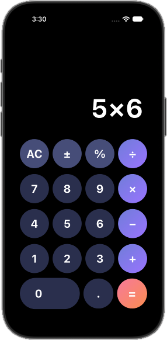
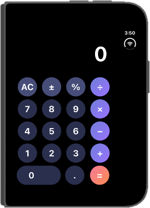
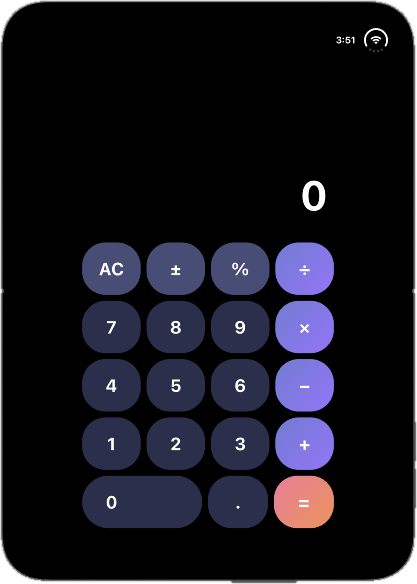
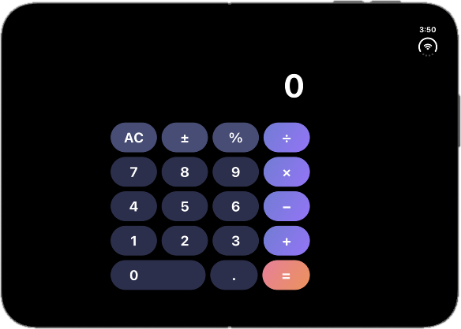

# Flutter Calculator

A clean, responsive calculator app built with Flutter. Circular gradient keys on phones, rounded-square keys on wider screens, and a calculator engine that is completely separate from the UI.

## Screenshots

**Phone and narrow screens** have circular keys:

<p align="center">
  
  &nbsp;&nbsp;&nbsp;
  
</p>

**Wider screens** (above 500 px) switch to rounded-square keys and a centered, width-limited keypad:

<p align="center">
  
  &nbsp;&nbsp;&nbsp;
  
</p>

## Features

- Digits, decimal point and the four operations: `+`, `−`, `×`, `÷`
- Chained calculations: `5 + 3 × 2 =` gives `16`
- Sign toggle `±`, percent `%` and `AC` (clear)
- The screen shows the whole expression as you type, for example `52.4+3`
- Safe handling of edge cases:
  - Division by zero shows `Error`, and `AC` recovers
  - Floating-point noise is removed (`0.1 + 0.2` shows `0.3`)
  - Very large or very small results switch to scientific notation (`1e+13`)
  - Long numbers shrink to fit the screen instead of overflowing
  - Pressing two operators in a row replaces the first
- Responsive layout: the buttons change shape above 500 px wide, and an in-progress calculation survives window resizing or rotation
- Custom app icon and a dark theme with gradient operator keys

## Getting started

**Requirements:** [Flutter SDK](https://docs.flutter.dev/get-started/install) (Dart `^3.13.3`)

```bash
git clone https://github.com/<your-username>/<repo-name>.git
cd <repo-name>
flutter pub get
flutter run
```

To regenerate the app icons after changing `assets/icon/app_icon.png`:

```bash
dart run flutter_launcher_icons
```

## Project structure

```
lib/
├── main.dart                     # App entry point and theme
├── logic/
│   └── calculator_logic.dart     # Calculator engine (plain Dart, no Flutter imports)
└── ui/
    ├── calculator_screen.dart    # Responsive shell: layout and per-width theme
    ├── calculator_ui.dart        # Display and keypad, owns the engine instance
    └── calculator_button.dart    # Reusable gradient / solid key widget
assets/
└── icon/                         # App icon sources
screenshots/                      # Images used in this README
```

## How it works

The engine keeps four pieces of state, and every key press goes through one method, `press(String key)`:

| State | Purpose |
|---|---|
| `_input` | the number currently being typed |
| `_first` | the stored first number |
| `_operator` | the pending operator |
| `_newNumber` | whether the next digit starts a fresh number |

The text on screen is a getter built from this state, so it can never fall out of sync with the numbers being calculated.

```
key tap → CalculatorUI._onKey → CalculatorLogic.press → setState → display getter → screen
```

Because the engine has no Flutter dependency, it can be unit tested on its own.

## Design decisions

- **One screen, not one per device size.** The widget tree has the same shape at every width, and only values like the theme and max width change. Flutter therefore keeps the calculator state when the window is resized.
- **Logic separated from UI.** `CalculatorLogic` can be tested and reused without widgets.
- **Theme-driven button shape.** Keys read their shape from the theme, so one `Theme` override changes every button.

## Possible improvements

- [ ] Unit tests for `CalculatorLogic`
- [ ] Backspace key
- [ ] Calculation history
- [ ] iPhone-style percent (`200 + 10 %` = `220`)
- [ ] Light theme
- [ ] State management refactor (Riverpod) as a v1.1

## Author

Made by Ragib as a Flutter practice project.

<!-- License: add a LICENSE file (for example MIT) if you want others to reuse this code. -->
